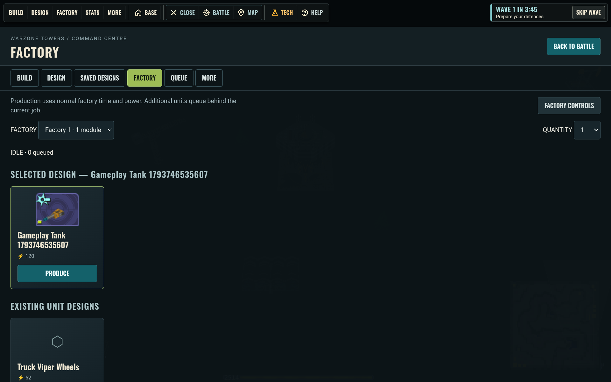
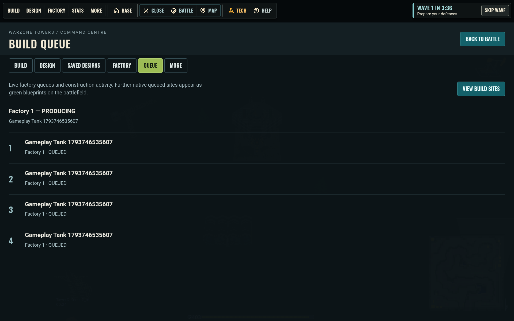
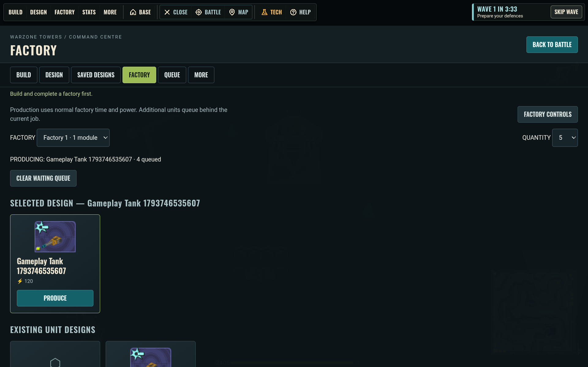
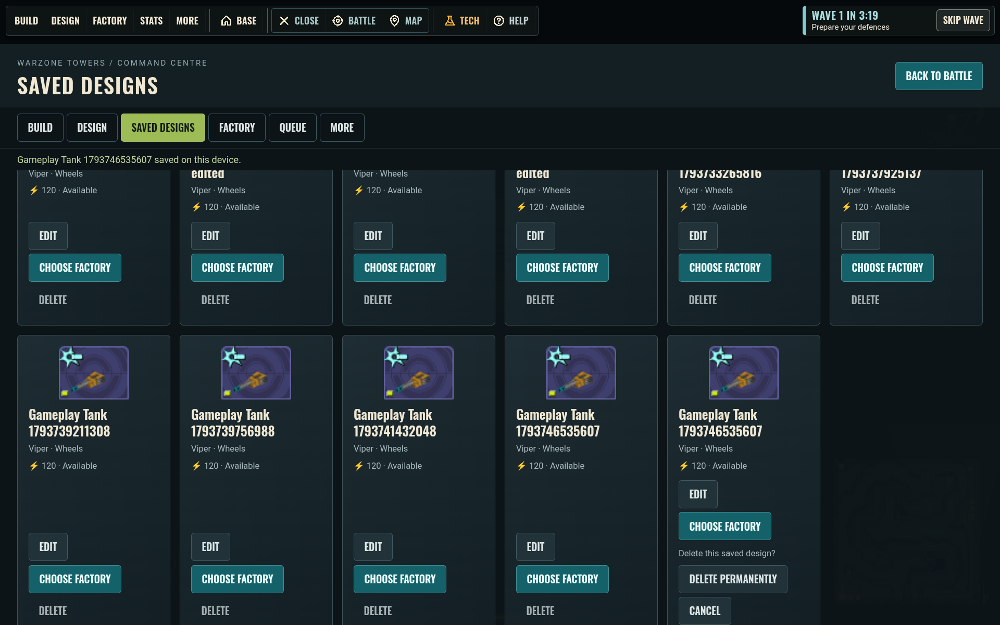
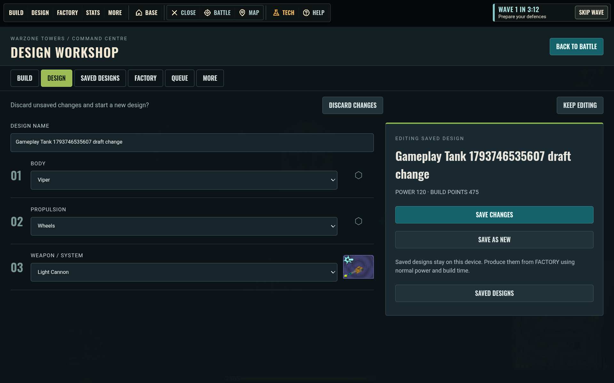
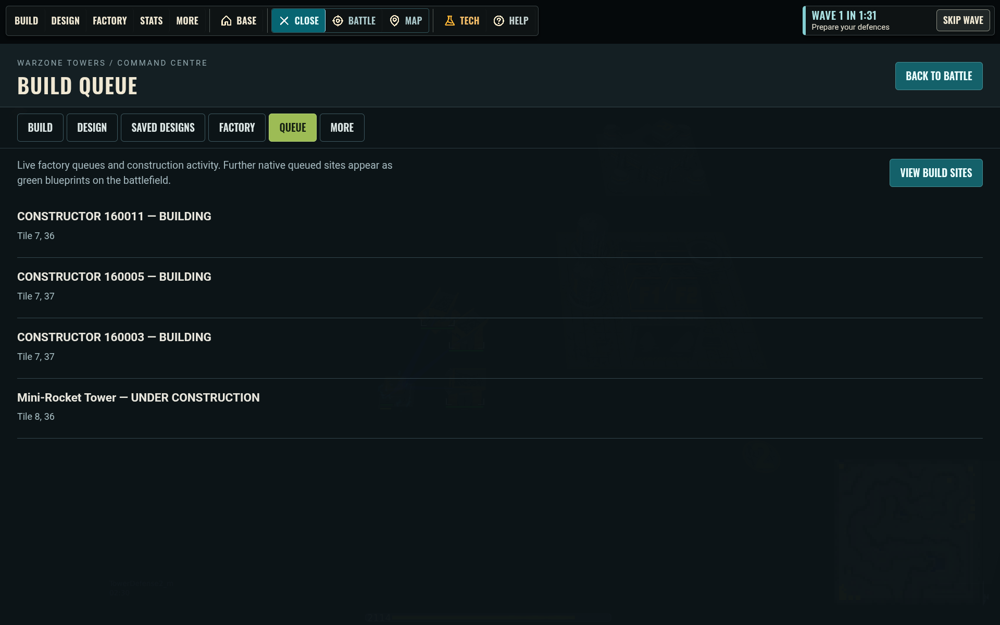
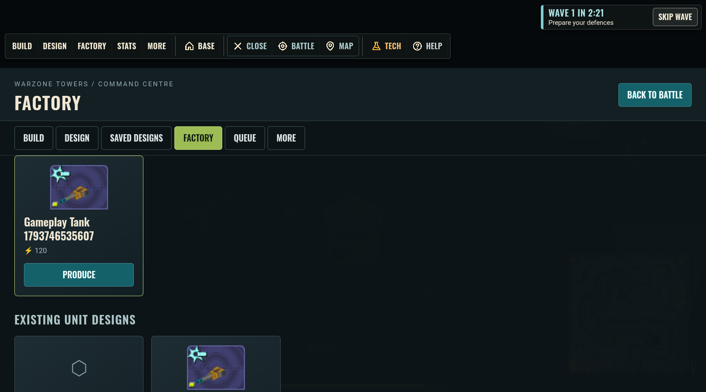
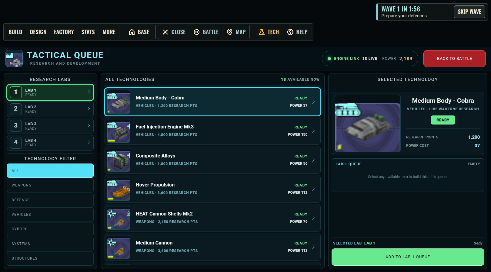
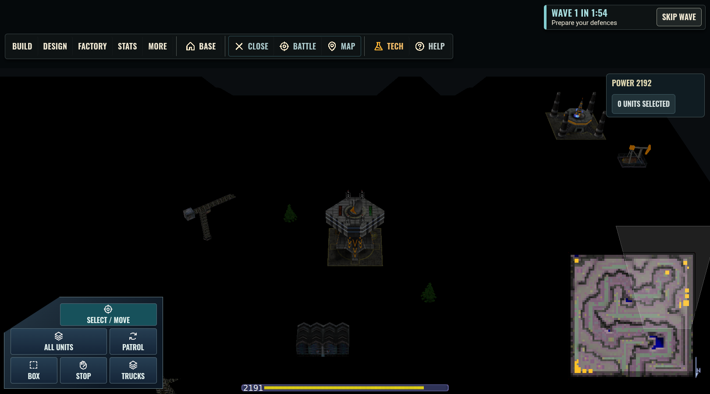

# v5.1 functional screen fixes

Status: affected flows passed on the installed delivery APK. Visual redesign is deferred.

APK SHA-256: `c1ed550f9024c1a5a2e80d771a4c31b40de7c504a56137be628ea6cbda1dbc0d`.

## Fixed in this pass

- Saved designs use CHOOSE FACTORY, retain the chosen design, and reveal its production button even after the Factory page was previously scrolled. Native units precede the rest of the saved library.
- Stock/generated templates with identical components appear once. Normal constructor and chosen-tank production were exercised; no free units or faster game speed were used.
- Queue now shows live factory active/waiting jobs, working constructors and unfinished native structures. Detailed future native build sites remain green blueprints on the battlefield; this page does not claim a full native pending-order list.
- Battle toasts are cleared on page entry; page feedback uses the page status area. Field controls are hidden while a command page is open and restored on return.
- DELETE requires an explicit confirmation, with a visible Cancel action. Leaving the page cancels that confirmation. Failed storage preserves the design and reports the failure.
- Starting a new design protects unsaved edits, including after visiting Saved. Keep Editing retains the draft; Discard explicitly resets it. The confirmation is brought into view.
- Factory clear/retry replies surface native errors. A deliberately invalid factory request was rejected by the actual bridge and displayed in the screen; its waiting queue remained intact and a later valid clear succeeded.
- Header measurement runs in a coalesced animation frame, writes only changed values, observes late header elements/fonts and uses a shared CSS height. The current launch logged zero ResizeObserver loop warnings. The original intermittent upward jump was not reproduced, so this is layout hardening, not physical-device certification.

## Emulator verification

Pixel_10_Pro, Android 16, SwiftShader, -no-audio. Viewports: 1280x800 and 1080x600.

| Flow | Evidence / outcome |
| --- | --- |
| Saved design → Factory | Chosen name and card retained; production button visible and hit-testable, including retained scroll |
| Production | Real selected unit and constructor produced; equivalent constructor template count remains one |
| Queue | Actual active/waiting production jobs and native construction visible |
| Error recovery | Real native factory rejection displayed; valid waiting-queue clear works |
| Library protection | Save-as-new disposable copy; Delete/Cancel preserves it, confirmed Delete removes only the copy |
| Draft protection | Edited draft survives Saved → New → Keep Editing; explicit Discard creates a new draft |
| Page returns | Three Design/Factory cycles at each size; native canvas extent, header/control hit targets and zero root scrolling verified |
| Research | Open/return checked and screenshots inspected at both sizes; all 408 research-named APK files match frozen v5.0 exactly |
| Build activity | Real native Mini-Rocket Tower foundation appears with its working constructors in Queue; return preserves the battlefield |

All 17 regression scripts, build, APK signature and engine/data preservation checks passed. The official engine and WASM are identical. The complete 66,158,381-byte v5.0 data prefix is preserved; 3,283 prior resolved stock/mod records are unchanged apart from explicit custom scenario overrides.

The final artifact gate is [final-tests.json](final-tests.json). Only wide/ and compact/ evidence with its APK hash certifies this APK. prototype-* captures belong to earlier candidates.

## Screens inspected

## Deferred / limits

Top-interface BUILD choices, replacement of grey native pickers, removal of MORE, simpler panels and assembled-unit previews belong to the later redesign. Research retains its design.

Black terrain remains on the emulator. Software-keyboard occlusion, physical Samsung behavior and audio output remain unverified. This pass does not repeat the entire v5.0 gameplay/wave audit or certify every game state. Native build sites continue to use the working original queue/blueprint system.
