# Current interface audit — 4 November 2026

First-pass visual and wrapper-code audit of released v5.0; redesign deferred.

APK SHA-256: `1b99ef69e369a75c86ee42e1c545874b57293083cc476ccc6357aa2421e30006`. No app runtime source was modified and no new APK was built.

[Visual report with screenshots](REPORT.html) · [Machine-readable findings](audit.json)

## Issues, before implementation

### F1 · BUILD opens the wrong interface

High — Confirmed. The top BUILD button selects nearby constructors and opens the original left construction sidebar. Building choices are absent from the intended top interface. open('build') immediately routes to openBuild(), which sends native-menu/build; renderBuild() is bypassed.

Code: `app/src/main/assets/warzone-command-pages.js:121`.

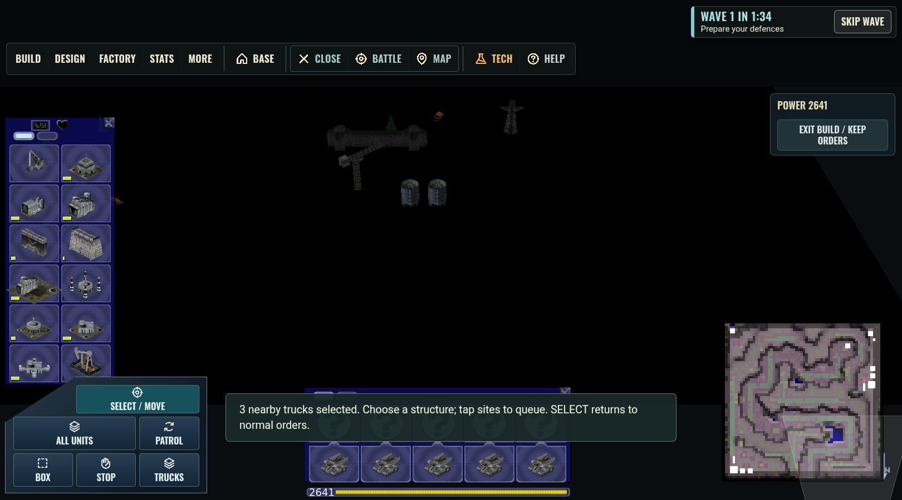

### F2 · Grey Android component and factory popups

High — Confirmed. Body and factory choices open a light Android/WebView select popup over the dark game panels. This reproduces the reported grey popup. HTML select controls create these OS surfaces; styling the closed select does not theme the open popup. Their appearance needs an integrated game chooser in the later redesign.

Code: `app/src/main/assets/warzone-command-pages.js:187`.

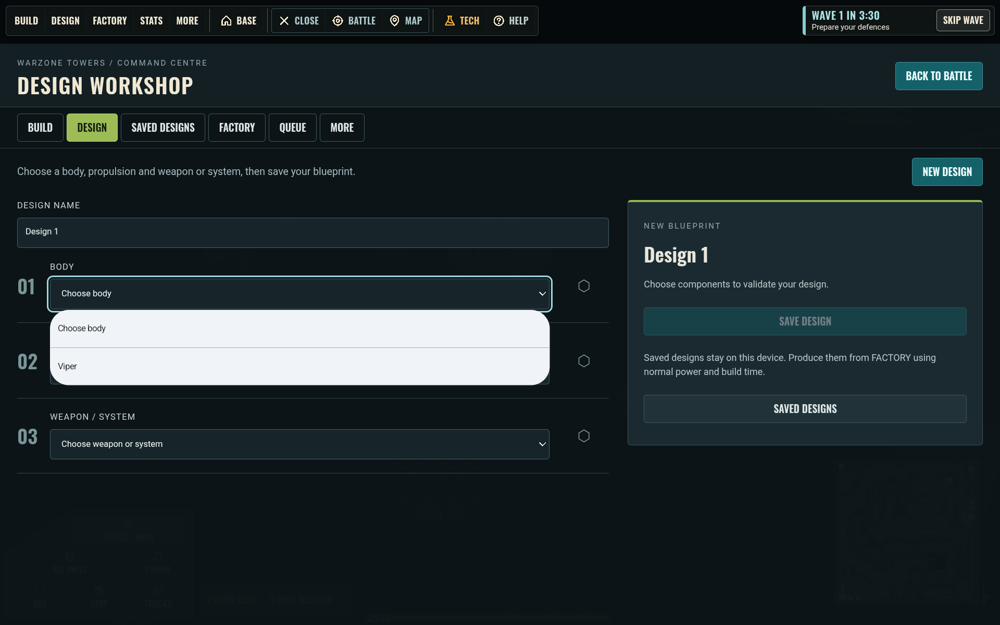

### F3 · Stacked navigation consumes too much screen

High — Confirmed. Battle toolbar, large page title, a second navigation row and introductory text remain stacked. At 1080x600 the page content starts at y=237.875: almost 40% of the screen is consumed before the working area. The command strip alone is 104px high. The designer's weapon field is below the initial visible area.

Code: `app/src/main/assets/warzone/ui/command-pages.css:6`.

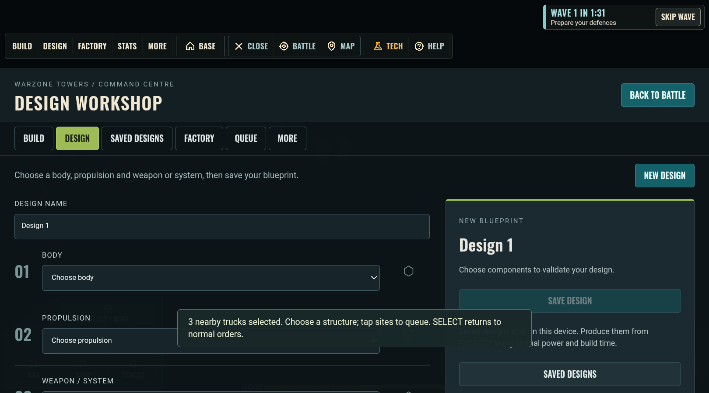

### F4 · Factory hides basic units behind the saved library

High — Confirmed. All researched saved designs render before existing native templates. With the populated emulator library, basic constructors and their PRODUCE button are below multiple rows. A visible click after deliberately scrolling successfully queues a constructor; the problem is discoverability and layout, not proof that the production engine is broken.

Code: `app/src/main/assets/warzone-command-pages.js:198`.

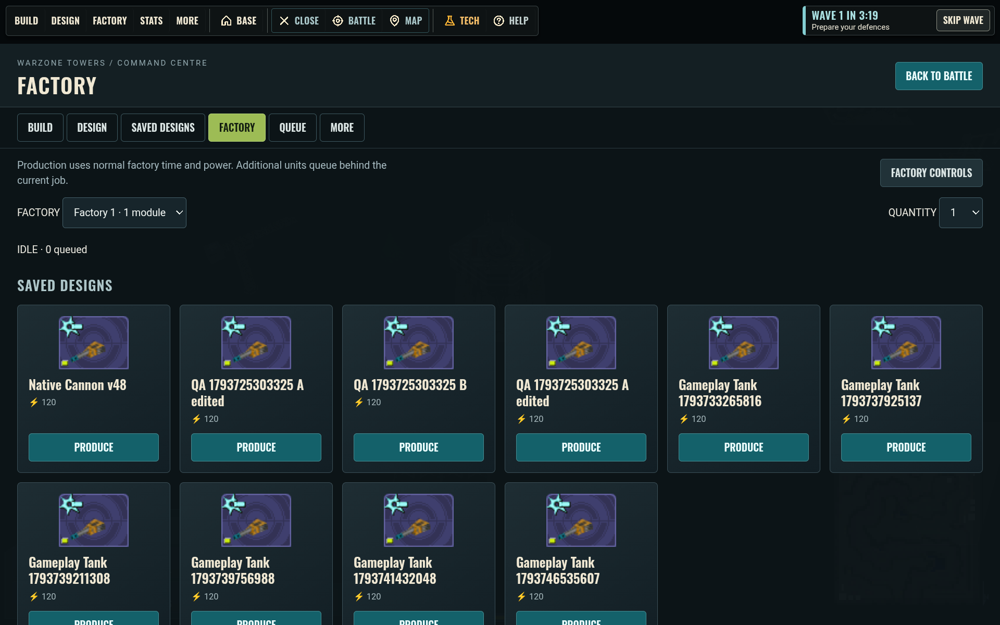

### F5 · Saved-design PRODUCE loses the selected design

High — Code-confirmed and navigation observed. The button stores state.selected and opens Factory, but state.selected has no reader elsewhere in this module. Factory neither selects, highlights nor scrolls to that design and does not queue it. The user must find it again. The control needs a clear handoff to the chosen design and explicit production confirmation.

Code: `app/src/main/assets/warzone-command-pages.js:405`.

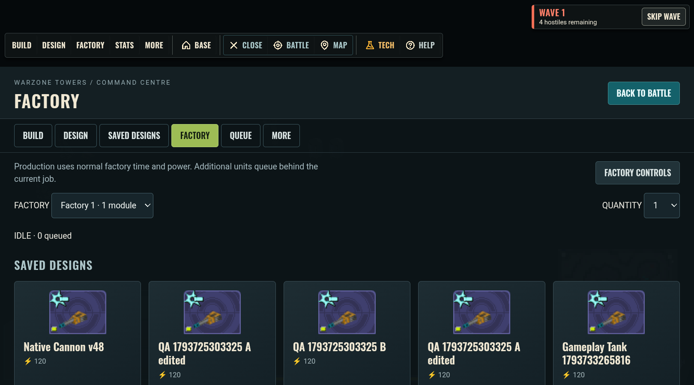

### F6 · BUILD QUEUE is an instructions page rather than a queue

High — Confirmed with code. The screen contains explanatory text, another BACK TO BATTLE button and NATIVE BUILD MENU, but no order list or progress. renderQueue() never reads native pending work. The old queueRows() belongs to the unused legacy route. This does not satisfy the screen's label.

Code: `app/src/main/assets/warzone-command-pages.js:209`.

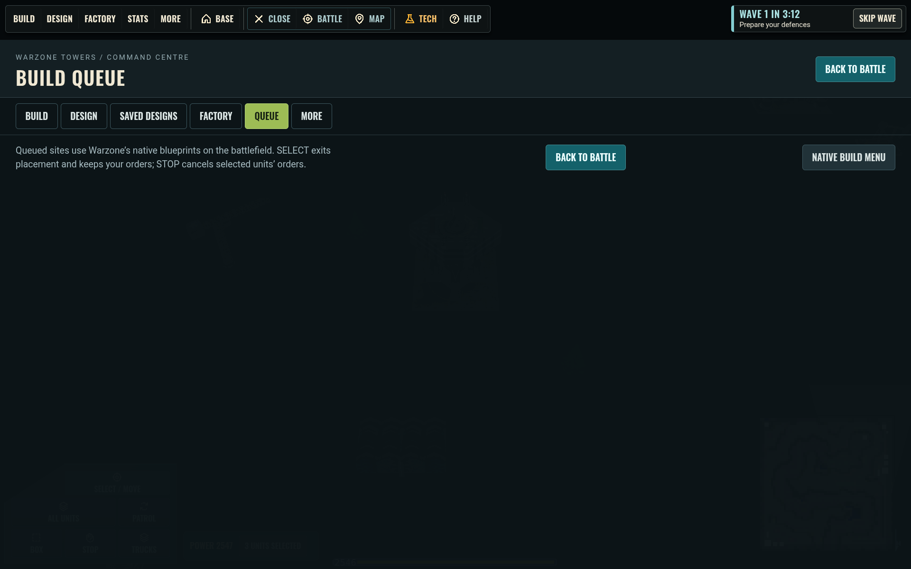

### F7 · MORE duplicates controls already available in battle

Medium — Confirmed. MORE repeats ALL, PATROL and BOX and adds another full page. It appears in both navigation rows. Removal is a stated requirement. Commanders and control size still need an explicit home so removing the button does not silently remove those functions.

Code: `app/src/main/assets/warzone-command-pages.js:212`.

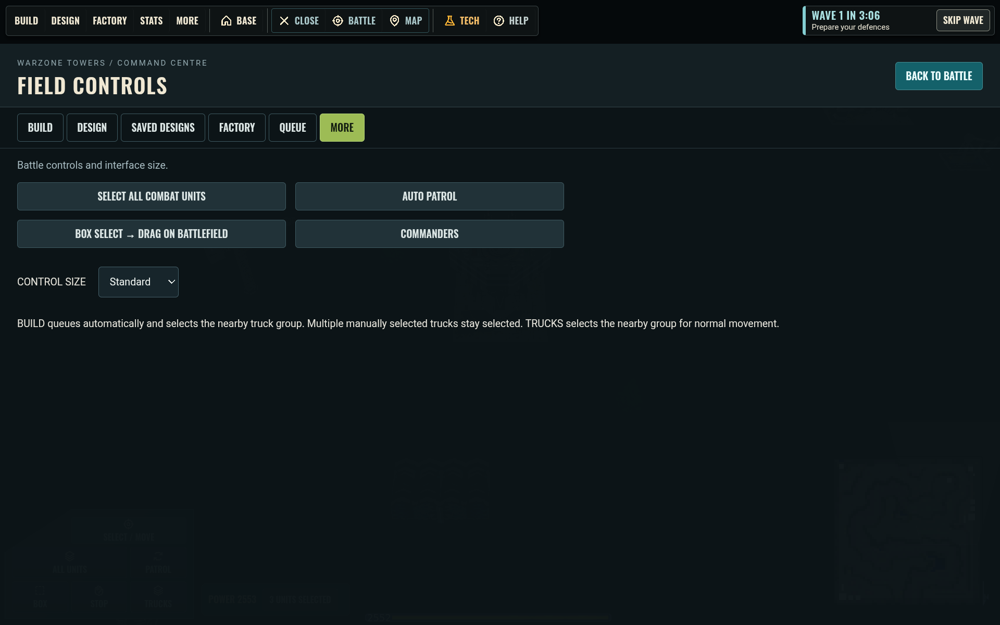

### F8 · Battle messages obscure Design

Medium — Confirmed. The constructor-selection toast remains over the designer after navigation; a production toast also overlays an edited design. notify() always shows a fixed floating toast. These messages should be scoped to the active screen or its status area.

Code: `app/src/main/assets/warzone-command-pages.js:71`.

### F9 · Underlying battle controls show through page panels

Medium — Confirmed. The page background is translucent and the field console remains rendered underneath it. Ghosted selection buttons and power/status text add visual noise to Design, Factory, Queue and Saved. Research already hides these controls and should retain its design.

Code: `app/src/main/assets/warzone/ui/command-pages.css:3`.

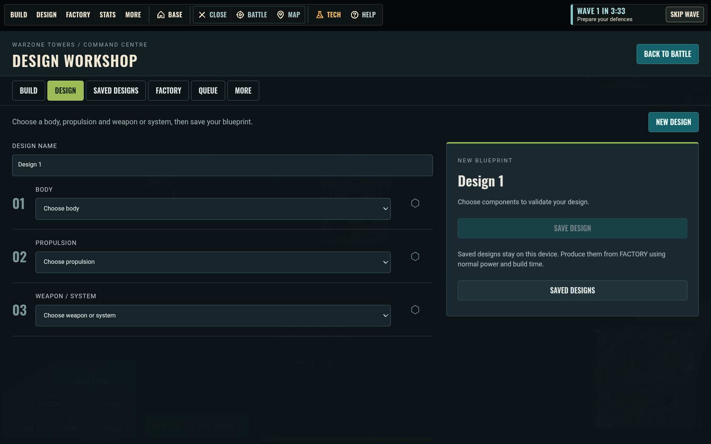

### F10 · Cards do not communicate the assembled unit

Medium — Confirmed. Factory and Saved cards mainly show a weapon research icon. Similar designs therefore look identical. In a populated design the selected Viper body and Wheels still show generic hexagon fallbacks. Large cards and repeated text amplify the webpage appearance rather than helping compare units.

Code: `app/src/main/assets/warzone-command-pages.js:206`.

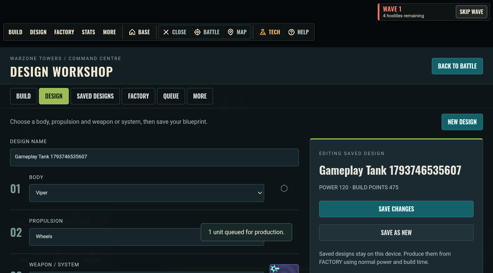

### F11 · Design deletion and draft replacement have no recovery step

Medium — Code finding; destructive action not exercised. DELETE immediately filters the saved library and persists it, with no undo or confirmation. NEW DESIGN immediately resets the current draft. A failed deletion persistence restores the list silently. These need protection or clear recovery in the functional pass.

Code: `app/src/main/assets/warzone-command-pages.js:404`.

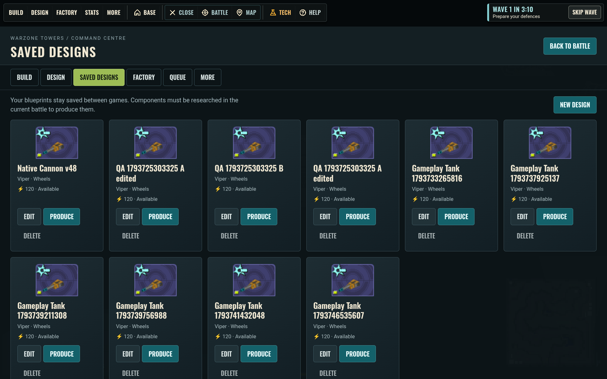

### F12 · Factory queue-clear/retry failures are ignored

Medium — Code finding; rejection not injected into live match. The clear-production/retry-production handler requests state after any reply without checking reply.ok or displaying reply.reason. A rejection can look like an unresponsive button. Successful production requests already have error handling; this handler should be consistent.

Code: `app/src/main/assets/warzone-command-pages.js:413`.

### F13 · Startup/header positioning still needs a targeted fix

High investigation — User report unresolved; code and runtime warning found. The reported upward/offscreen shift was not reproduced in captured geometry: no negative header top or host scrolling was recorded. Code splits header sizing across Android fitViewport(), host 50/94px rules, CSS top=7/51px and JS measured minimums 56/100px. A ResizeObserver loop warning was logged on replay startup. This is a concrete layout-maintenance problem, but it is not proof of the user's exact root cause and must not be marked fixed.

Code: `app/src/main/java/com/rbabbit/blocknight/warzone/MainActivity.java:292`.

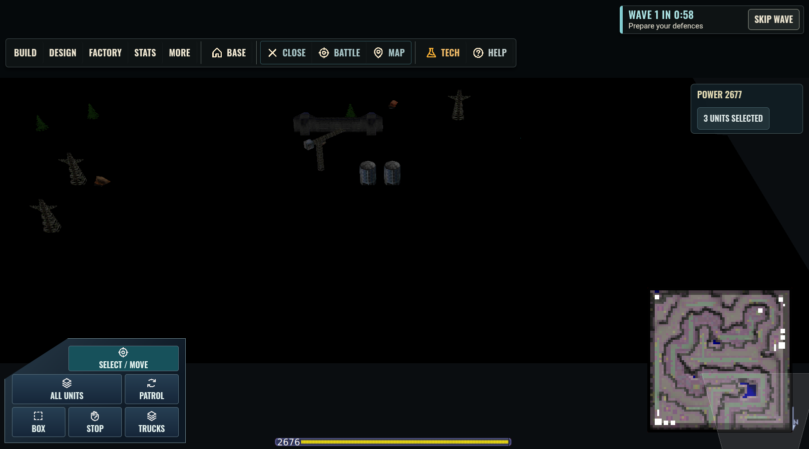

### F14 · An equivalent constructor appears twice after production

Medium — Confirmed. The native-template section shows both Truck Viper Wheels and Truck Viper Wheels · F160157, each costing 62 power, after a constructor production request. The original stock template and generated factory template are both exposed. Existing deduplication does not merge this stock/generated pair. The production chooser should present one equivalent unit choice.

Code: `scenario/warzone-towers-commands.js`.

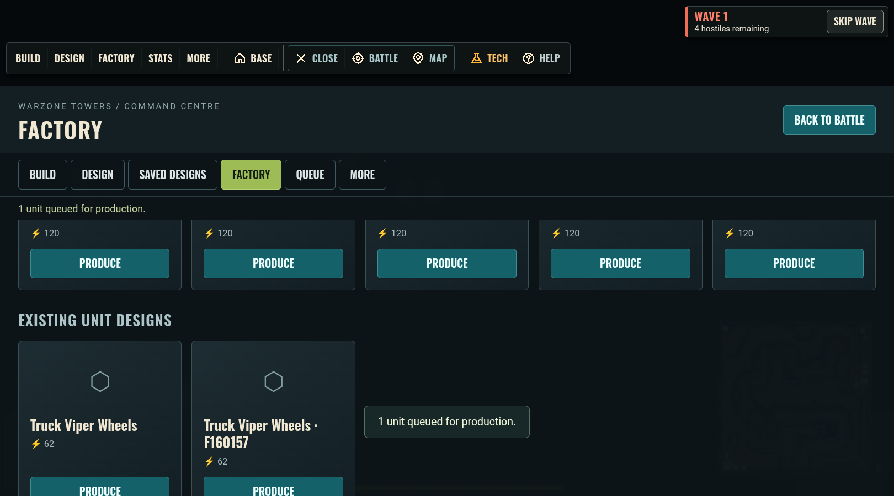

## Steps and health

| Step | Screen / interaction | Health | Evidence |
| --- | --- | --- | --- |
| 1 | Battle entry / late startup | Partial: header geometry captured; first wide image is transitional, not a stable reference | [1280×800](before/01-battle.png) · [1080×600](compact/01-battle.png) |
| 2 | BUILD | Wrong interface: native sidebar rather than top choices | [1280×800](before/02-build-sidebar.png) · [1080×600](compact/02-build-sidebar.png) |
| 3 | Design overview | Crowded; compact weapon choice below initial view | [1280×800](before/03-design.png) · [1080×600](compact/03-design.png) |
| 4 | Body picker | Grey native popup reproduced | [1280×800](before/04-body-popup.png) · [1080×600](compact/04-body-popup.png) |
| 5 | Name field focus | Focus visible; software keyboard absent, occlusion unverified | [1280×800](before/05-design-keyboard.png) · [1080×600](compact/05-design-keyboard.png) |
| 6 | Back after name focus | Geometry retained; not proof of actual keyboard dismissal | [1280×800](before/06-keyboard-dismissed.png) · [1080×600](compact/06-keyboard-dismissed.png) |
| 7 | Return from Design | Battlefield and controls visible at both sizes | [1280×800](before/07-design-return.png) · [1080×600](compact/07-design-return.png) |
| 8 | Factory overview | Crowded library hides native units below saved designs | [1280×800](before/08-factory.png) · [1080×600](compact/08-factory.png) |
| 9 | Factory picker | Same native popup mismatch | [1280×800](before/09-factory-popup.png) · [1080×600](compact/09-factory-popup.png) |
| 10 | Initial production attempt | Rejected as proof: offscreen control was missed; superseded by edge check | [1280×800](before/10-production-queued.png) · [1080×600](compact/10-production-queued.png) |
| 11 | Construction queue page | No actual queue rows: instructions only | [1280×800](before/11-queue.png) · [1080×600](compact/11-queue.png) |
| 12 | Saved designs | Renders; large repeated cards and unsafe delete handler | [1280×800](before/12-saved.png) · [1080×600](compact/12-saved.png) |
| 13 | MORE | Redundant controls; removal remains required | [1280×800](before/13-more.png) · [1080×600](compact/13-more.png) |
| 14 | Research | Layout coherent at both sizes; retain design | [1280×800](before/14-research.png) · [1080×600](compact/14-research.png) |
| 15 | Return from Research | Battlefield and controls restored | [1280×800](before/15-research-return.png) · [1080×600](compact/15-research-return.png) |
| 16 | Help | Readable and scrollable; text references current sidebar/MORE and needs later updating | [1280×800](before/16-help.png) · [1080×600](compact/16-help.png) |
| 17 | Return from Help | Battlefield and controls visible | [1280×800](before/17-final-battle.png) · [1080×600](compact/17-final-battle.png) |
| 18 | Saved PRODUCE handoff | Selected design lost in Factory; edge capture only | [1080×600](compact/18-saved-produce-destination.png) |
| 19 | Visible native-template production | Actual accepted queue request; equivalent constructor cards duplicated | [1080×600](compact/19-visible-template-queued.png) |
| 20 | Edit populated design | Component values and validation visible; body/propulsion fallback art | [1080×600](compact/20-populated-design.png) |
| 21 | Edge return / replay | Final edge return interrupted by replay; not a passed return check | [1080×600](compact/22-after-return-error.png) |

## Functional work before the visual redesign

1. Preserve the chosen saved design through Factory navigation; clarify navigation versus production.
2. Remove duplicate equivalent native templates and expose queue failures.
3. Scope messages to the active screen and protect destructive library actions.
4. Reproduce and consolidate header geometry, checking cold entry, replay, compact size and a genuinely visible keyboard.
5. Then implement top-interface BUILD choices, simplified Design/Factory/Queue screens and removal of MORE, preserving Research.

## Accessibility observations

Focus outlines are visible. Dense 30px-high toolbar controls, small helper copy, low-contrast disabled controls and content below the initial compact view need attention. No screen-reader or full contrast/compliance assessment was performed.

## Evidence limits and diagnostics

- This is an audit, not a redesigned or repaired APK. App source and version remain v5.0.
- The emulator contains a populated library from earlier QA. These names are emulator data, not bundled starter designs.
- Name-field focus was captured, but the software keyboard did not visibly open, even with show_ime_with_hard_keyboard enabled. Keyboard occlusion and viewport restoration are not certified by those captures.
- The first wide battle capture contains a selecting overlay and is rejected as a stable startup reference. Stable battle returns are available in steps 7, 15 and 17.
- The initial step-10 captures show IDLE: an offscreen production button was not actually clicked. They are rejected as production proof. The later edge capture scrolls only the content pane, verifies a visible hit target and confirms a native factory active/queued job.
- The edge run completed navigation to Factory and a real queue request, then reopened a populated design. Its final return was interrupted by a replay. The replay URL marker and Java replay handler explain the reload; this is not certified as a random menu-return crash. Game-over overlay appearing over an in-progress tap is a code risk because any click on the native full-screen panel starts replay.
- Logs contain the existing WASM streaming compilation TypeError followed by ArrayBuffer fallback, GFXSTREAM warnings and a ResizeObserver loop warning. No clean-console claim is made.
- A native System UI not responding dialog was dismissed at launch. It is an emulator system failure, not attributed to the game.
- Black terrain remains on this emulator. Physical Samsung, audible output, every research/module/late-game state and full accessibility compliance are outside this pass.
