# v5.2 tactical interface — emulator verification

Final result: passed for the flows listed below. This does not certify every possible game state or physical device.

APK SHA-256: `2bc1fee640277eacacfd21f8c9d4b72fc19a23c304461f5c026efb0b71f20441`.

Additional command-page/header checks used the screenshot's 1600x720 aspect ratio. The exact delivery APK was installed and tested at 1280×800 and 1080×600 WebView sizes. BUILD, DESIGN, BLUEPRINTS, FACTORY and QUEUE now share Research's visual style; Research assets remain unchanged.

## Issues and fixes

| Reported/discovered issue | Result | Evidence |
|---|---|---|
| BUILD only selected trucks | Header BUILD now opens the structure menu; PLACE STRUCTURE activates the chosen native tool. | [native results](wide/tactical-build-results.json) |
| Wrong structure after choosing a card | Corrected native row coordinates and the Tank Traps catalogue collision; native saved orders confirm the chosen structure. | [native results](wide/tactical-build-results.json) |
| Only part of a nearby constructor group selected | Connected local grouping includes the opposite edge of the same area. One edge truck expands to all fifteen. | [native results](wide/tactical-large-results.json) |
| TRUCKS used the previous camera location | Wait for fresh terrain projection after reactivating its observer; camera-switch selection is exercised in the large-group fixture. | [native results](wide/tactical-large-results.json) |
| Queued construction invisible / stale neon preview | Original native green blueprints show accepted future sites; three real structures complete and placement exits automatically. | [native results](wide/tactical-build-results.json) |
| Placement closed between queued buildings | Require sustained native idle time; a brief gap between sites no longer exits placement before the last structure completes. | [native results](compact/tactical-build-results.json) |
| Trucks and combat units could not be selected/moved | Battlefield touch selection, nearby TRUCKS, ALL UNITS, BOX, MOVE, PATROL and STOP verified against native orders/positions. | [native results](compact/controls-results.json) |
| Unpolished grey component popup | Three button-based component steps and a persistent blueprint summary replace visible native selectors. | [native results](compact/tactical-screens-results.json) |
| First SAVE click sometimes ignored | Name changes no longer rebuild and destroy the SAVE button during pointer-down; actual first-click save tested. | [native results](wide/tactical-screens-results.json) |
| Factory clutter and narrow rows | Facility rail, full-width unit rows, explicit quantities and a live queue; selected blueprint remains first. | [native results](wide/functional-screens-results.json) |
| Saved draft reopened with disabled save controls | Header DESIGN revalidates a complete saved draft without requiring another edit; checked by actual native validation at both sizes. | [native results](wide/tactical-screens-results.json) |
| Unavailable saved parts were lost during a name edit | The draft retains locked component identities; native research validation still prevents unavailable production. Deterministic draft regression covers this. | [native results](regressions.txt) |
| Manufactured blueprints cluttered Factory with internal IDs | Generated copies of saved blueprints no longer add duplicate rows; stock constructors remain accessible and internal factory suffixes are hidden. | [native results](screenshot-aspect/50-factory.png) |
| Stock designs showed empty internal components | Hide default ZNULL systems and show the three meaningful constructor components. | [native results](wide/tactical-screens-results.json) |
| MORE hid important controls | MORE removed. Field commands remain visible; Commanders/control sizes moved to Help. | [native results](compact/tactical-extra-results.json) |
| Top banner shifted/clipped after page/keyboard returns | Fixed root overflow and measured wrapping header; actual keyboard and repeated returns checked at both sizes. | [native results](compact/tactical-screens-results.json) |
| Returning from production corrupted the battlefield | Real tank/truck production followed by field selection, movement and repeated page returns at both sizes. | [native results](wide/tactical-screens-results.json) |
| Large building and module path needed verification | Chosen 2×2 Factory and Factory Module completed in the native engine. | [native results](wide/tactical-facility-results.json) |
| Research must stay unchanged | All 408 research-named APK files are identical; TECH open/close retested. | [native results](research-preservation.json) |
| Build/scripts were mistaken for gameplay evidence | Exact installed APK hashes, Android touches, screenshots, native save orders/completion/positions and actual wave weapon firing form the final gate. | [native results](final-tests.json) |

## Native gameplay checks

Both sizes passed three chosen queued defence completions, automatic placement exit, actual constructor movement, real tank/constructor production, battlefield tank selection/movement, twelve command-page returns, actual software keyboard, Help and Research returns. The compact pass also exercised ALL UNITS, PATROL, STOP, BOX and TRUCKS, all control sizes, Stats, native Factory and Commanders returns. A chosen 2×2 Factory and its module completed. Skip Wave spawned native enemies and native saved records show actual weapon firing.

The fifteen-unit test uses the stock engine's debug cloning only to prepare ten real constructors in the owned emulator, plus two normally produced constructors and three original constructors. Remote constructors are removed from that fixture. Debug mode is disabled before the test. From one constructor at the edge (more than eight tiles from the far side), BUILD selects all fifteen; all fifteen receive real native work and three chosen structures complete. This is a selection/queue test, not a claim that all fifteen were manufactured. Ordinary production is checked separately through visible Factory controls. No debug feature was added to the delivery APK.

The final gate also checks all regression scripts, APK signature, source-to-APK identity, original engine/WASM/data preservation and all 408 Research assets. Earlier failed prototypes are retained under `prototype/`; stale or differently hashed evidence cannot satisfy the gate.

## Remaining limits

- Emulator black terrain is pre-existing in Normal and HQ. Physical Samsung behavior, cutouts, HQ appearance and audible quality remain unverified.
- Future construction sites use native battlefield blueprints. QUEUE lists current construction and real factory jobs; the public API does not expose every native future build order.
- A copied native QuickSave test fixture failed to recreate the custom scenario script context. That fixture was abandoned and fresh sessions used. Native Save/Load is not certified by this pass.

## Screen evidence

### BUILD opens choices

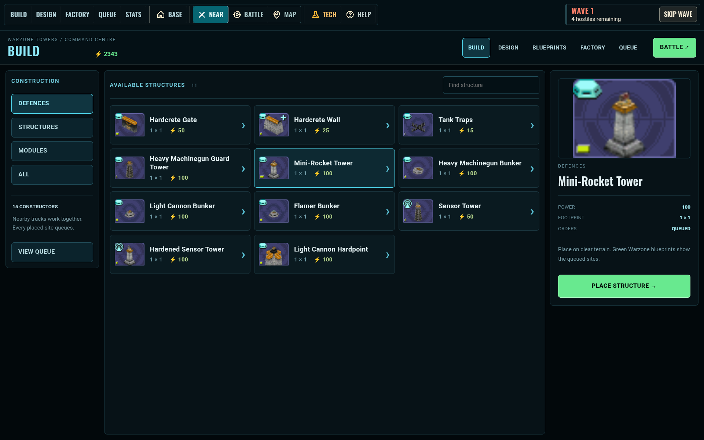

### Original queued blueprints

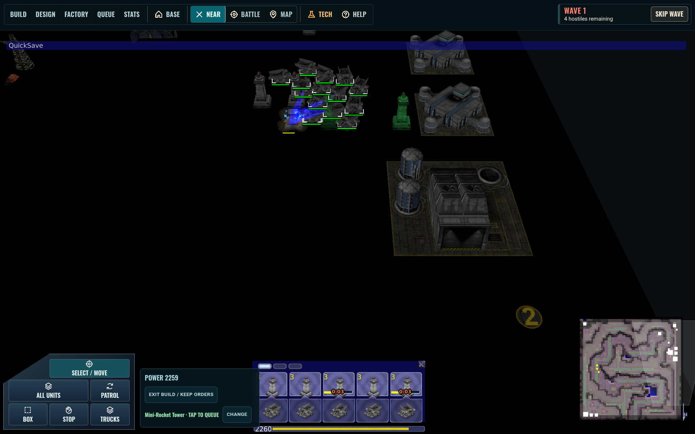

### Fifteen constructors and completed work

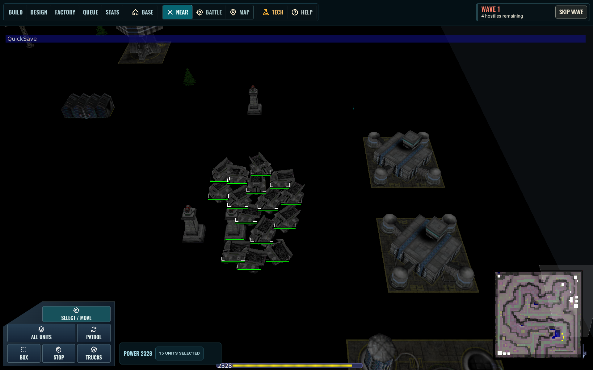

### Integrated DESIGN components

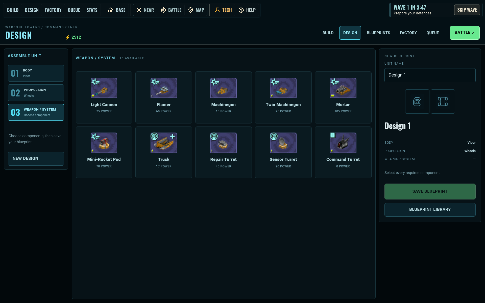

### FACTORY and selected blueprint

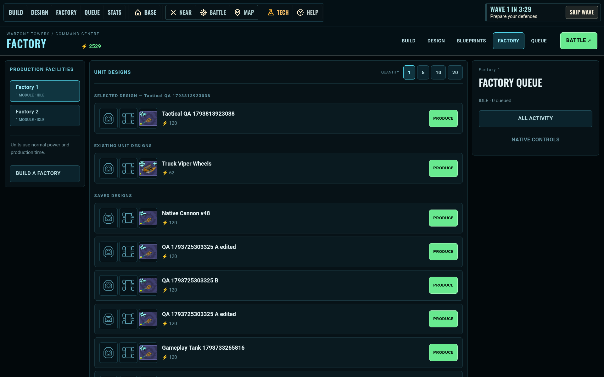

### Live production queue

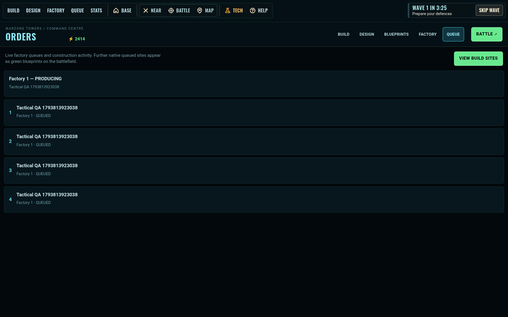

### Actual keyboard; stable header

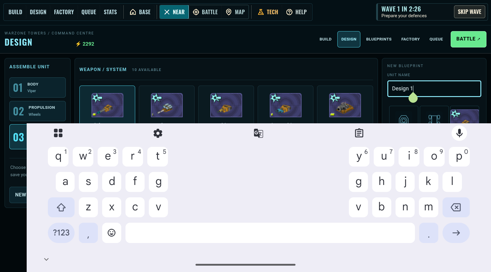

### Compact battlefield after returns

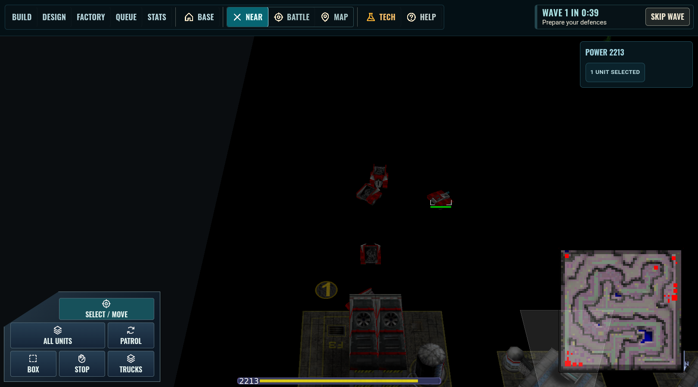

### Always-visible field controls at largest size

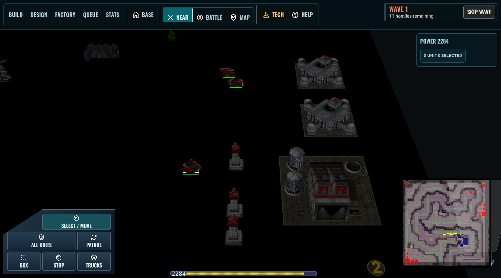

### Factory module completion

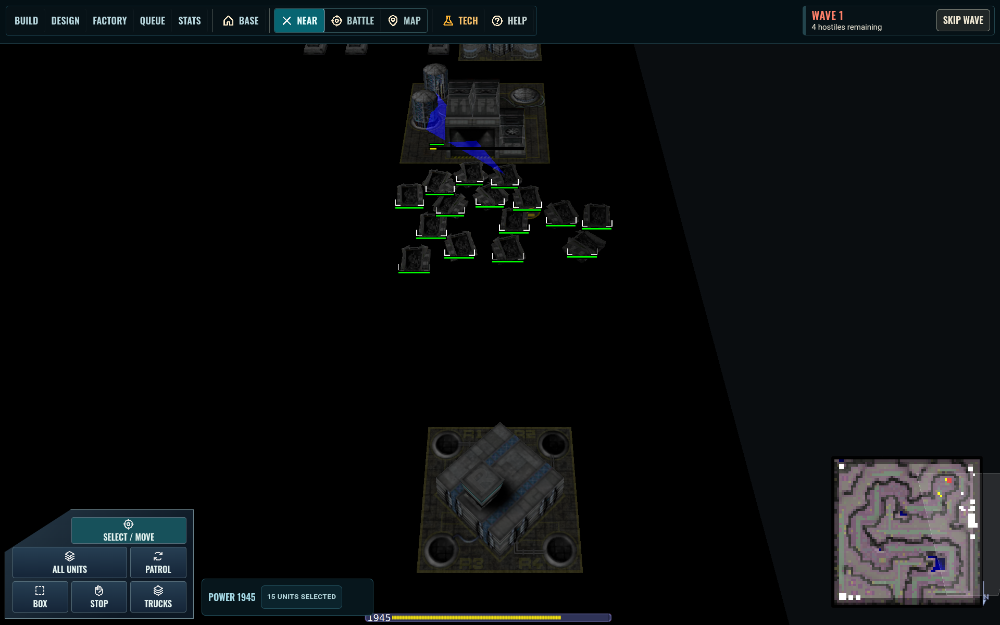

### Native wave combat

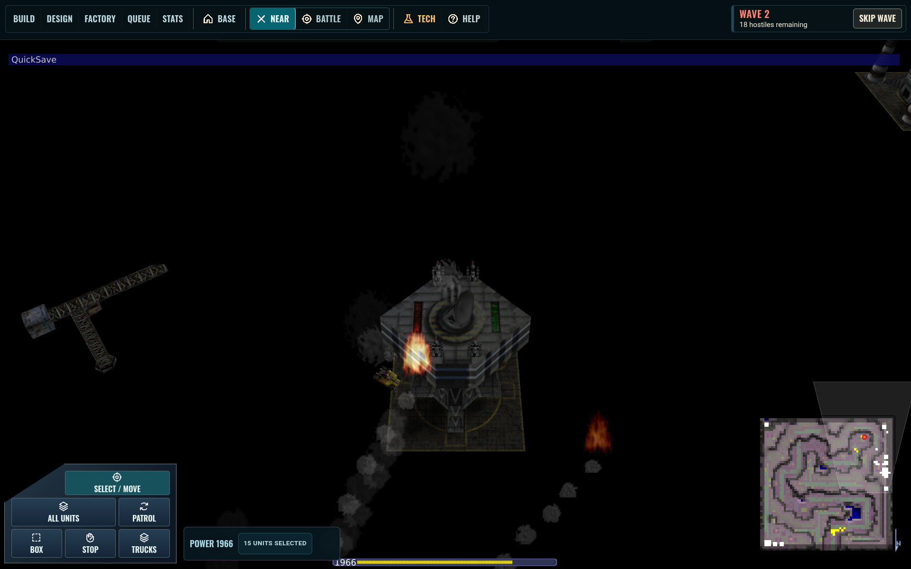

### Screenshot-aspect BUILD

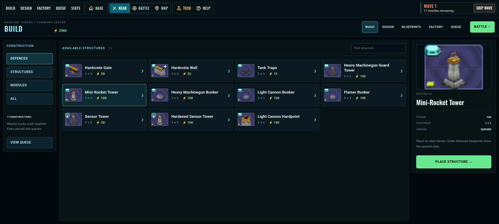

### Screenshot-aspect DESIGN

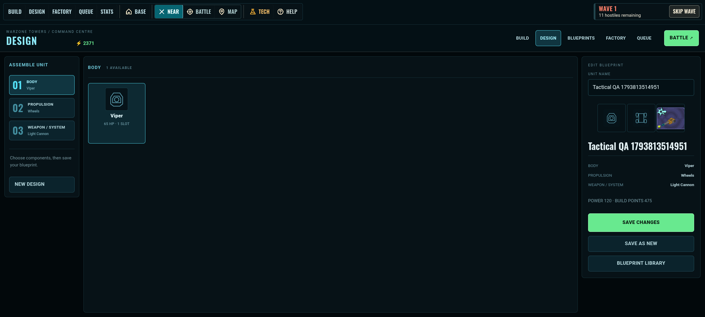

